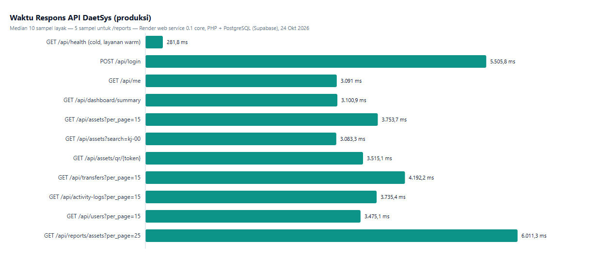
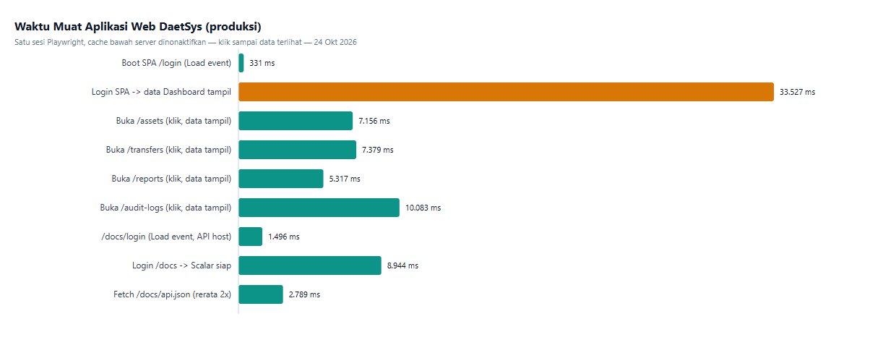

# Statistik Kecepatan Aplikasi (Produksi)

Pengukuran dilakukan pada **24 Oktober 2026** terhadap lingkungan produksi yang sama dengan subbab [Lingkungan produksi (live)](ANSWER.MD#lingkungan-produksi-live) di dokumen studi kasus:

- **API backend:** `https://daetsysapi.onrender.com` (Render web service, PHP CLI server, `PHP_CLI_SERVER_WORKERS=4`, ~0,1 core)
- **Database:** PostgreSQL (Supabase, koneksi mulai dari server Render)
- **Aplikasi web (frontend):** `https://daetsys.onrender.com` (Render static site)

Data mentah tersimpan di [`answer-docs/perf/`](https://github.com/maschollan/DaetSys/tree/main/answer-docs/perf): `api-raw.json` dan `web-raw.json`. Grafik batang dirender dari `chart-api.html` dan `chart-web.html` di folder yang sama.

## Metodologi API

- Skrip PowerShell dengan `HttpClient` yang dipakai ulang (satu koneksi TCP/TLS per seri pengukuran).
- **Satu request "cold"** ke `/api/health` sebelum apapun, untuk menangkap kondisi layanan yang tertidur. Pengukuran dilakukan secara natural: tidak menunggu layanan idle terlebih dahulu, sehingga hasil request pertama bergantung pada apakah service kebetulan sedang tidur atau hangat.
- **Satu request login** (`POST /api/login`, dibatasi sekali per sesi untuk menghormati throttle 5 request/menit).
- **10 sampel per endpoint** (5 sampel untuk `/api/reports/*` yang memiliki rate limit 30 menit) dengan jeda 1,5–2,5 detik; semua request membawa token Bearer.
- Tabel menampilkan **median**, **p95** (persentil ke-95 dari sampel), dan ukuran payload rata-rata. Semua sampel mengembalikan status `200`.

## Hasil API

| Endpoint | Median | p95 | Payload rata-rata |
|----------|-------:|----:|------------------:|
| `GET /api/health` (request pertama sesi) | 281,8 ms | — | — |
| `POST /api/login` | 5.505,8 ms | — | — |
| `GET /api/me` | 3.091 ms | 5.589,6 ms | 0,3 KB |
| `GET /api/dashboard/summary` | 3.100,9 ms | 6.325,2 ms | 0,2 KB |
| `GET /api/assets?per_page=15` | 3.753,7 ms | 7.046,3 ms | 7,9 KB |
| `GET /api/assets?search=kj-00` | 3.083,3 ms | 5.059,9 ms | 0,7 KB |
| `GET /api/assets/qr/{token}` | 3.515,1 ms | 6.362,5 ms | 0,5 KB |
| `GET /api/transfers?per_page=15` | 4.192,2 ms | 6.996,8 ms | 5 KB |
| `GET /api/activity-logs?per_page=15` | 3.735,4 ms | 6.892,6 ms | 7,2 KB |
| `GET /api/users?per_page=15` | 3.475,1 ms | 6.367,9 ms | 3 KB |
| `GET /api/reports/assets?per_page=25` | 6.011,3 ms | 7.825,8 ms | 12,5 KB |

Catatan penting dari angka di atas:

- **Boot layanan:** request pertama sesi pengukuran selesai dalam **281,8 ms**. Pada dua percobaan sesi sebelumnya, request pertama yang sama memakan **3,7–4,3 detik** — layanan Render memang sempat tertidur, tetapi pada sesi pencatatan final ia sudah hangat. Angka "cold" di sini adalah *rekomendasi berhati-hati*: cold boot sebenarnya bisa bermilidetik lebih lambat tergantung keberuntungan jadwal Render.
- **Login ≈ 5,5 detik** didominasi verifikasi bcrypt (perancangan hashing memang mahal biaya CPU) di atas instance 0,1 core. Nilai ini normal untuk instance paling kecil; di CPU yang lebih layak, hasilnya turun drastis.
- **Median endpoint data ≈ 3–4 detik** untuk dataset yang kecil (40 aset demo). Latensi ini bukan berasal dari query database (payload hanya 0,2–12,5 KB), melainkan **minimnya jatah CPU instance** — setiap request menunggu durasi CPU yang sama yang panjang.
- `/api/reports/assets` paling lama (6,0 detik) karena mengagregasi dan menyusun laporan; ini konsisten dengan struktur laporan yang lebih berat dari endpoint list biasa.

## Metodologi Aplikasi Web

- Browser **Chromium via Playwright**, viewport 1280×800, dari jaringan pengujian (Indonesia) menuju Render.
- Setiap pengukuran dimulai dari **cookies dibersihkan** dan **cache HTTP dimatikan** (CDP `Network.setCacheDisabled`), sehingga aset statis benar-benar diunduh ulang.
- Angka "buka halaman" adalah waktu dari **klik tautan navigasi sampai data tabel terlihat** di layar (melalui skeleton "Memuat…"), bukan hanya event `load` halaman.

## Hasil Aplikasi Web

| Alur | Waktu |
|------|------:|
| Boot SPA `/login` (event `load`, SPA statis) | **331 ms** (TTFB 138 ms, ~140 KB sumber) |
| Login SPA → data Dashboard tampil | **33.527 ms** |
| Buka `/assets` (klik → data tampil) | 7.156 ms |
| Buka `/transfers` (klik → data tampil) | 7.379 ms |
| Buka `/reports` (klik → data tampil) | 5.317 ms |
| Buka `/audit-logs` (klik → data tampil) | 10.083 ms |
| `/docs/login` di API host (event `load`) | 1.496 ms (TTFB 1.454 ms) |
| Login `/docs` → dokumentasi Scalar siap | 8.944 ms |
| Fetch `/docs/api.json` (2 sampel) | 1.578 ms & 3.979 ms (16 KB) |

Detail XHR pada login → dashboard (keenam request diluncurkan **paralel** oleh frontend):

| XHR | Durasi |
|-----|-------:|
| `POST /api/login` | 8.127 ms |
| `GET /api/dashboard/summary` | 15.168 ms |
| `GET /api/dashboard/assets-by-location` | 10.653 ms |
| `GET /api/dashboard/assets-by-status` | 22.003 ms |
| `GET /api/dashboard/recent-activities` | 25.166 ms |
| `GET /api/dashboard/pending-transfers` | 19.085 ms |

Baris terpanjang di grafik web (33,5 detik) bukan karena frontend lambat — boot SPA sendiri hanya 331 ms. Keenam XHR paralel berbagi **4 worker PHP di instance 0,1 core**, sehingga durasi tiap request digilir oleh antrean CPU yang sama yang membuat median endpoint API 3–4 detik. Frontend bekerja wajar: ia hanya menunggu backend.

## Interpretasi dan batasan

1. **Angka ini bukan bukti skenario 500.000 aset.** Dataset produksi sengaja kecil (aset demo), jadi pengukuran ini membuktikan *fungsionalitas dan latensi dasar* deployment, bukan performa skala besar seperti dibahas di Skenario 4 `ANSWER.MD`. Pengujian beban dengan seeder bervolume besar masih diperlukan untuk klaim itu.
2. **Instance 0,1 core adalah faktor dominan untuk semua angka API & web.** Bila langganan Render dinaikkan, angka median endpoint diperkirakan turun ke rentang ratusan milidetik; struktur kode (indeks, kunci transaksi, paginasi) sudah mendukung itu.
3. **SPA deep-link refresh masih 404** pada sesi pengukuran: aturan rewrite `/* → /index.html` belum diatur di Render dashboard (berkas `frontend/public/_redirects` tidak diproses oleh Render static site). Langkah manual tersebut ada di dokumentasi deployment dan tidak selesai lewat repo saja.
4. **CORS preflight valid** selama pengukuran (`204` dengan header `Access-Control-Allow-Origin` yang benar); error CORS berlebih beberapa kali selama sesi bersifat sementara dan hilang dengan sendirinya.
5. Rate limit produksi dihormati selama pengukuran: login hanya 1 request per sesi, sampel `/api/reports/*` 5 request dengan jeda lebih panjang.
